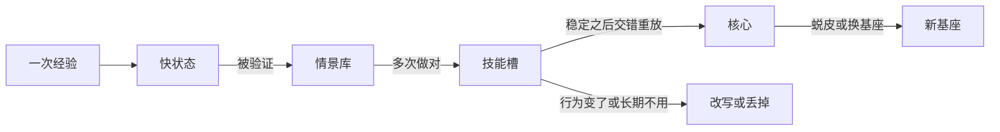
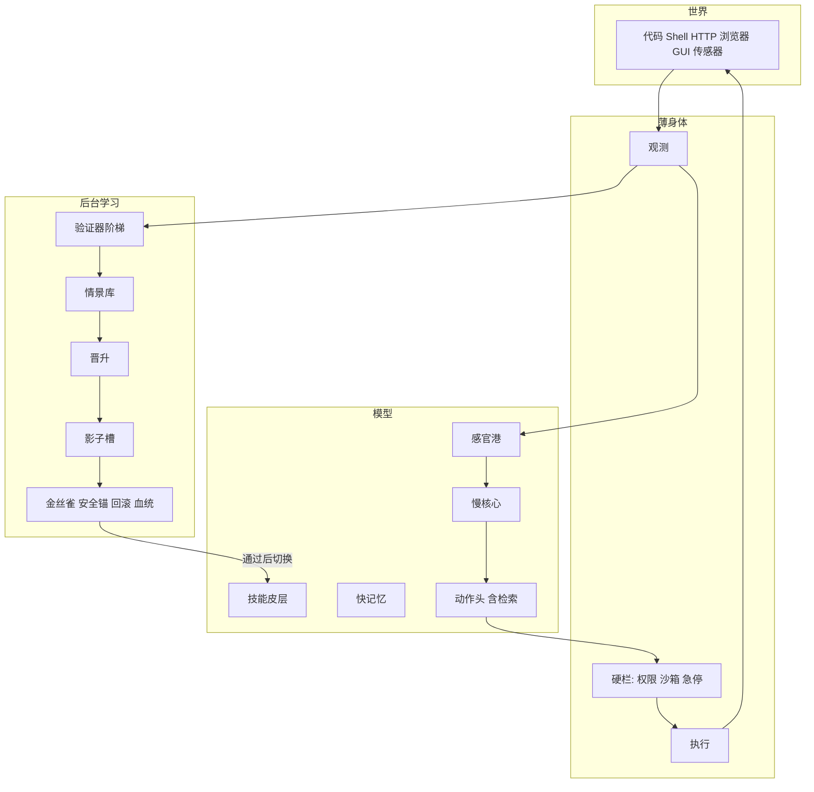

# 架构

这份文档说明 `evo` 现在是什么，以及它要长成的生命体模型是什么。路线、闸门和失败后的转向在 [ROADMAP.md](ROADMAP.md)。

## 现在的系统

基座是本地的 Qwen2.5-0.5B 或 1.5B，4-bit NF4，上面挂 LoRA。`policy` 管行为，`memory` 管知识，`scratch` 用来试一次更新。新工具可以再开一块 `slot_XX`，用中间层隐状态的余弦选一块，旧槽冻住。实现在 [evo/model.py](../evo/model.py) 和 [evo/world/skills.py](../evo/world/skills.py)。

世界每天生成基座没见过的虚构工具。模型只写 Python，沙箱执行，对错看输出。见 [evo/world/toolbox.py](../evo/world/toolbox.py) 和 [evo/world/body.py](../evo/world/body.py)。

一天的循环在 [evo/phase4.py](../evo/phase4.py)。白天权重不动，base、agent、evolved 考同一张卷。agent 的权重冻着，用 BM25 把说明书和旧解法放进提示词。`oracle: true` 时多一个上限组：说明书和历史解法全部放进上下文，不截断。夜里 [evo/world/sleep.py](../evo/world/sleep.py) 把执行器核对过的做法写进 LoRA，然后过技能、保留、串联、探针四道门。整晚要么留下，要么回到快照。每一代适配器都写在 `runs/*/lineage.json`。

`hand_curriculum` 默认开着。关掉之后，夜里不再做这个世界专用的课程：串联放到最后、保留链、收尾绑定、尾部修正。验证过的做法还是会学。`exam_pool` 用工具的 `held_args` 把考卷加长，这些参数本来就不进夜间训练。每题的对错写在当天的 `items` 里，给配对区间用。

快记忆是最后一层旁边的 delta 规则状态，[evo/fastmem.py](../evo/fastmem.py)。单独开着它，第二次作答并没有变好。另有一个约 2100 万参数的小模型，带多频率快权重，[evo/arch/selfmod.py](../evo/arch/selfmod.py)，不参与这天的循环。

`refs/` 里的 SEAL、mithilai-SEAL、STABLE、Absolute Zero、Nested Learning 是读过的参考，不是 fork。借来的是三件事：核对过再写入、变差就退回、用执行器而不是人口头判分。

## 已经知道的事

- 知识自编辑阶段的提升大多来自题目泄漏。诚实考法下，留出 F1 是 0.125。
- 只学成功样本的外循环，在 0.5B/1.5B 上弱于没训练过的自编辑。
- 模型说自己对不对，不能当奖励。
- 只靠快状态守不住旧领域。权重里要重放旧数据。
- 1.5B 十天普查的种子 0：最后早晨 0.67 对 0.33，用字 341 对 2824。每天 6 题，这个差距的功效不够，见 [BASELINE_V1.md](BASELINE_V1.md)。

## 五条生长法则

1. 晋升。经验按「快状态 → 情景库 → 技能槽 → 核心」往上走，每一级都要有证据。过时的改写或丢掉。
2. 生长。先用工具，后长器官。新能力先是一次调用，再写进权重，最后才变成动作 token、感官港或输出头。取代脚手架和长出新感官是同一件事。
3. 事务。每次写权重都可验证、可撤销、可追溯。线上一直用已经提交的那一版。
4. 进化。一个个体负责学习。一群个体负责进化「怎么学」。环境生成器和个体一起变，让任务停在学得会的那一档。
5. 身份。身份是情景库、技能槽和血统，不是某一个检查点。基座可以换。也可以定期把技能槽蒸回核心，再开空槽。

## 目标结构

几档时间同时走，不轮班。秒级改快状态。分钟级把验证过的成功写进影子槽，金丝雀通过才切换。天级把稳定技能蒸进核心，有 KL 预算。周级进化学法。月级才长新结构或换基座。

学习进行时，对外服务的仍是上一版已提交权重。候选写在 `cand` 适配器上，见 [evo/live/consolidator.py](../evo/live/consolidator.py)。

写入分三档，规则在 [evo/live/promote.py](../evo/live/promote.py)。一次做对只留在快状态里，优化器不动。同一工具再做对，才允许写技能适配器 `policy`。写进去之后，后面的考试还连续做对，才允许写慢核 `memory`。工具行为一变，这个工具的记录清零，从快状态重新开始。行动时把 `policy` 和 `memory` 叠成一个适配器再生成，所以写进核心的那一次，下一次调用看得到。

第二裁判在 [evo/live/verifier.py](../evo/live/verifier.py)。程序若写出 `print(12)` 或 `assert answer == 4`，这是它自己声明的结果。声明和执行器比过足够多次、而且经常一致之后，声明才有否决权。在那之前，晋升只认执行器。模型口头说对，仍然不算。

身体的权限不在权重里。`python` 是默认允许的。写文件、开 shell、访问网络必须由外部授予，模型写进程序里的要求不算数。被拒绝的程序不会执行，也不会被当成一次成功晋升。见 [evo/live/rails.py](../evo/live/rails.py)。

换基座时带走的是身份，不是检查点。身份是验证过的练习、每个工具的晋升计数，和学习基因。考题不在里面。见 [evo/live/identity.py](../evo/live/identity.py)。

下一具身体是一个会改口的服务，不是沙箱里预先塞好的函数。答对要有两行：动作 `HTTP GET /名字/参数`，以及返回的数字。只有动作、没有数字，不算做对。说明书里有步长，没有考试用的参数。服务把其中一个接口的步长加一之后，拿着旧说明书的那一方只在这个接口上答错，另一个接口还是对的。不看说明书、只记得上次返回值的一方，第一次会错，记住之后能做对，接口一改又会错一次。吸收率是：说明书方仍然做对的题里，不看说明书的一方也做对的比例。见 [evo/live/service.py](../evo/live/service.py)。

## 写入层级

做对一次不改权重。`Ledger`（[evo/live/promote.py](../evo/live/promote.py)）按工具计数：

- 未达到重复次数：只留在快状态里，优化器不动。
- 同一工具反复做对：写入 `policy`，这是技能层。
- 这个技能之后的考试仍然通过：下一次才允许写入 `memory`，这是慢核心。带说明书的老师只能教技能层，不能直接改核心。
- 工具行为变了：该工具的计数清零，从快状态重新挣。

奖励目前只有执行器。[evo/live/verifier.py](../evo/live/verifier.py) 规定第二级检查器要先在已知对错上跟执行器对齐，才可以取代执行器。没对齐之前，模型自己说对不算数。

## 连续学习内核

[evo/live/](../evo/live/) 是阶段 1 的循环，不替换原来的日夜循环。日夜循环留着当倒班对照。

- `episodic.py` 收练习，拒绝 `split == "exam"` 的条目。
- `triggers.py` 决定这次是写入、向带说明书的自己学，还是什么都不做。步数用完或还在冷却，就不动。
- `canary.py` 从考题里分层抽几道，另外扫描 `os.system`、`subprocess`、路径跳出这类调用。
- `onpolicy.py` 从裸模型采样，留下高于批内均值的程序，再在学生自己的续写上算 student 到 teacher 的 KL。老师的提示里有说明书，学生的提示里没有。
- `stream.py` 用同一条任务流跑六组：agent、上下文上限、倒班、连续、连续但没有快记忆、连续但只用成功样本。学习的几组共享同一步数上限。
- `compare.py` 做配对区间、回本点和闸门 1。
- `probe_qwen.py` 检查 Qwen3.5 能不能在这张卡上做 4-bit LoRA，以及缓存状态能不能接到下一次前向。

私有、易变的数据和密钥不进权重。模型以后要学的是何时自己去取，而不是把库背下来。

## 对照

从低到高：裸模型，BM25 agent，全量上下文上限，倒班写入，连续写入。更大的冻结模型和外部 API 只在阶段 2 以后当参照，不进这张卡上的第一步对比。

外部考场也在阶段 2：CL-Bench、ServeLearnBench、EvoArena、PATH-Bench。那些基准量的是外挂记忆。我们在上面加一条权重学习的记录。

## 第三版：电脑身体和办公考场

玩具世界从 `evo/tests/test_toy_freeze.py` 起冻结。新考场是电脑上的数字工作，不是随机音节函数。

电脑身体在 [evo/computer/](../evo/computer/)。它没有权重。动作是 Qwen3.5 预训练见过的工具调用：`python`、`shell`、`read_file`、`write_file`、`list_dir`、`http`、`finish`。权限在 [evo/computer/license.py](../evo/computer/license.py)，模型改不了自己的授权。命令行只有 `mkdir`、`dir`、`type`、`copy`。HTTP 只连授权主机，开发时是本机。路径不能跳出工作区。删除、付款、发送要人确认。影子模式只记方案，不改文件。

办公考场在 [evo/office/](../evo/office/)。每个任务族有两套生成器和一份隐藏的参考解法。验证器看最终状态：表格合计、文件是否搬走、报告里的数字、服务里记下的对账结果。参考解法必须通过，什么都不做和故意写错必须失败，见 [evo/office/verify.py](../evo/office/verify.py)。本地服务在 [evo/office/services.py](../evo/office/services.py)，带令牌、分页、错误码，以及改名、分页、日期三种漂移。

开发行业包是订单、报销、考勤、运单，在 [evo/office/packs.py](../evo/office/packs.py)。留出包封在 [evo/office/heldout.py](../evo/office/heldout.py)，开发流不能导入。打开封条的规矩在 [GENERALITY.md](GENERALITY.md)。

学习是双节律，决定在 [evo/live/rhythm.py](../evo/live/rhythm.py)：

- 白天，同一类任务验证成功达到次数后，写一小批进 `policy`，当天就能用，写错可以清掉。
- 夜里按睡眠压力整理：预算用完、环境漂移、空闲、一段工作结束。新旧交错重放，再蒸进技能槽。
- 晨报写明留下了什么。人可以按名字回滚。

学到的东西分开存。通用核是跨行业还管用的操作。本地槽是这一家的文件、字段和习惯，不外传。夜班用 [evo/live/sorter.py](../evo/live/sorter.py) 分拣：别的包变差就丢掉，没有别的包可测就留在本地，别的包不差才进通用核候选。晋升账本在要求 `cross_holds` 时，考试通过但跨包次数不够，目的地是 `local` 而不是 `core`。

往外共享走 [evo/live/share.py](../evo/live/share.py)。交出去的是换成占位符的说明，不是本地适配器。私有字符串还在，导出就失败。两台部署的演练在 [evo/live/fleet.py](../evo/live/fleet.py)。

学什么由 [evo/live/absorb.py](../evo/live/absorb.py) 按回本次数决定。失败但凑巧做对了另一道题，由 [evo/live/relabel.py](../evo/live/relabel.py) 改标。多轮轨迹的 on-policy 在 `multiturn_update`。

七组对照在 [evo/office/stream.py](../evo/office/stream.py)：agent、oracle、shift、continual、dual、dual_agent、continual_sft。闸门在 [evo/office/judge.py](../evo/office/judge.py)。基座预设在 [evo/model.py](../evo/model.py) 的 `lora_preset`：`attn`、`attn_delta`、`full`、`day_delta`。Qwen3.5 用 `Qwen3_5ForConditionalGeneration` 加载，生成时关闭思考。0.8B 探针：基座损失约 3.12，短提示下 `2+2` 先答过 2 也答过 4，4-bit LoRA 能反传，delta 状态能接到下一步。2B 探针：显存约 3776MB，基座损失约 2.54，`2+2` 答 4，同样能做 4-bit LoRA，状态也能跨步。同一句「合计是 17」在 0.8B 上一步之后的损失：只写注意力 4.84，只写 DeltaNet 4.23，只写 MLP 2.88，注意力加 DeltaNet 3.79，三处都写 2.15（一步之前都是 5.39）。所以白天的小更新可以只动 DeltaNet，夜里要动损失就得带上 MLP。提示短于 1024 时，0.8B 不会发出工具调用；办公配置用 1024。

真实文件夹的三档放权在 [evo/office/pilot.py](../evo/office/pilot.py)：影子、半自动、自动。自动只放行已经验过的任务族。

## 会话封装

办公回路的写入收成 [evo/session/](../evo/session/)。`WritePolicy` 把三道已经存在的门合成一次决定：晋升账本、回本账本、夜班分拣。回本没到就继续检索。账本还在快状态就不写权重。分拣丢掉就丢掉。否则取更保守的一层：本地和技能槽都压过核心，本地又压过技能槽。

`OrganismSession` 走同一具电脑身体。每一步把任务、开口、工具、验证、账本、吸收、写入、睡眠和晨报写成事件。命令行仍打印字符串晨报，旁边有结构化的 `morning_card`。七组对照的日程没改。双节律在「反复做对」之后，多过这三道闸。

做对的记录在进优化器之前先收成一句：`sum {AMOUNT} where {STATUS} is {OK}; write {OUT}`。整段程序不进权重。训练和验收的题目先拿掉已经写明的做法，模型把题目念回来不算。身体拿本机对照表把这一句还原成工具调用。候选仍先写在 `cand` 上，做对才换上。回本用这一句的长度，不再把使用成本当成 0。标准答案脚本做对不算。小考试的四道加总，训练后能说出做法并且通过检查，也比把做法写在题目里好。搬文件的新问法能说出搬文件。写报告仍被说成加总。加总少看两遍还是这样，这场没通过。三次大闸门原文不改。

本机界面是 `python -m evo studio`。它把同一次过程摊开给人看：现场跑是真模型或标准答案，回放是已经落盘的记录。闸门成绩仍以 [ROADMAP.md](ROADMAP.md) 里当时的判定为准。界面不重新判卷，也不把标准答案说成模型会了。

写进哪一层按已经量过的一步损失来分。白天的小更新只训练 DeltaNet。夜里把技能整理进槽时，再加上 MLP。写进慢核心才同时动注意力、DeltaNet 和 MLP。分拣再加一档：轨迹里带着这一家的字段名，或者还没有第二家稳住，就留在本地，不进核心。往另一台送的时候，本地做法直接留下；就算是通用核，私有字符串还在就拒绝导出。练习没通过、但写出来的数正好是另一种合法合计时，只改标，不把所问的那一题记成做对，也不因此写权重。换基座时带走的是验过的练习和晋升计数，不是检查点，考题不在里面。这是学习规则，不是新的闸门判定。成绩和诊所排班已经作废。下一对留出包是借阅和仓库，还封着。

## 第四版：可塑性进化

前三版的学习算法是「验证过的成功样本上做监督更新」。进化只变异 7 个超参数。[docs/LITERATURE.md](LITERATURE.md) 把这件事放回文献里：它不在空白上。空白是预训练语言模型的学习规则能不能被进化，并且进化出来的东西可以遗传。

这一版把进化的对象从权重换成基因组。实现在 [evo/evolution/](../evo/evolution/) 和 [evo/plastic/](../evo/plastic/)。

基因组有 56 个数（[evo/evolution/genome.py](../evo/evolution/genome.py)）：4 个层组 × 3 个位置（注意力、DeltaNet、MLP）× 3 个时间尺度的学习率，4 个任务簇的分配和先天值，以及 12 个记忆基因（携带、衰减、巩固间隔、重放、KL 锚、写入门槛、出生尺度、三档混合、惊讶门、遗忘惩罚）。最后一组的基因占可塑性的大头，否则四组平均会把进化信号稀释平。

一个个体的一生由基因组决定学习率。[evo/plastic/learner.py](../evo/plastic/learner.py) 是机制模型，给定基因组后轨迹是确定的，选择不被采样噪声淹没。语言模型那条路在 [evo/plastic/lora_life.py](../evo/plastic/lora_life.py)：一组至少 8 条、温度大于 0 的采样（[evo/plastic/signal.py](../evo/plastic/signal.py)），做对的留下，没有做对才用执行器给出的目标，并且标明来源不是 on-policy。写哪些位置由基因组的中时间尺度决定（[evo/plastic/sites.py](../evo/plastic/sites.py)）。DeltaNet 的跨回合状态在 [evo/plastic/deltanet_carry.py](../evo/plastic/deltanet_carry.py)，携带基因接近 0 就不保留。

代际搜索有两条。[evo/evolution/es.py](../evo/evolution/es.py) 是 OpenAI-ES 和对角 CMA-ES，适应度是学习曲线面积减去出生水平，再减去没用到的位置的可塑性代价。同一次搜索里所有个体共用一个任务种子。[evo/evolution/population.py](../evo/evolution/population.py) 用截断选择比较三种继承：鲍德温只遗传基因组，达尔文按出生表现选择，拉马克把练会的簇写进先天基因。

评测在 [evo/bench/](../evo/bench/)。加速比是第 1 个新任务族达到合格所需的回合数，除以后面那个族的回合数，上限 50。任务族有三处：虚构工具 DSL（训练 12 族、留出 32 族，原语和「分支」模板不重叠）、Reasoning Gym（装了就用，否则用内置的可判分题）、办公包（只读开发包；封存的成绩、排班、借阅、仓库不导入，另有 8 个合成行业作留出）。

命令是 `python -m evo plast --stage all`。配置在 [configs/evoplast_all.yaml](../configs/evoplast_all.yaml)。笔记本走 transformers。Linux GPU 上的 vLLM 多 LoRA 推演写在 [docs/RUNTIME.md](RUNTIME.md)。

下面这些模块冻结，不再加功能：`evo/studio/`、`evo/live/share.py`、`evo/live/fleet.py`、`evo/live/sorter.py`、`evo/office/pilot.py`、`evo/session/procedure.py`。
