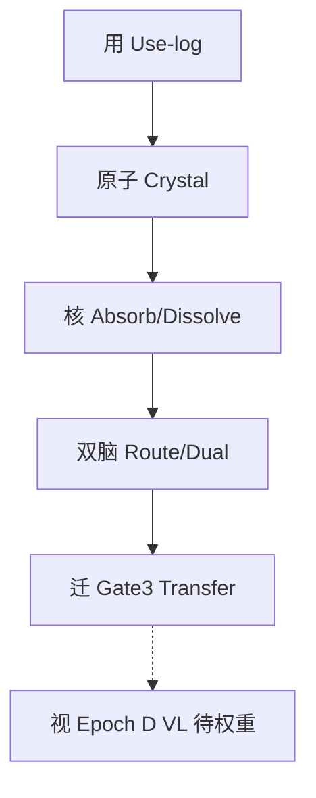

# 蚁算模型 · 主结构与升级地图

更新日期：2026-10-18（Asia/Shanghai）  
仓库引擎代号：Envolution（`E:\\envolution`）  
基座：Qwen2.5-1.5B · Gate **0.6** 不降 · 无 VL 假分

## 1. 定位

**蚁算模型**是「使用驱动进化」的产品模型：能力先在真实使用里留下痕迹，再结晶成可热插拔原子，再吸收进裸权重，最后用路由调度；目标是用进化内核替掉「大模型 + 厚 agent 脚手架」。

- 对外名：**蚁算模型**（上海蚁算 / Ant Compute）
- 引擎代号：可保留 **Envolution**
- 不是堆更多 agent；是把会的本事炼进身体里

## 2. 五层主结构（核 / 原子 / 双脑 / 迁 / 视）

| 层 | 蚁算叫法 | 英文 / 代码 | 做什么 | 现状 |
| --- | --- | --- | --- | --- |
| L1 Use | **用** | use-log / EventBus | 真实办公任务留下可回放痕迹（XML tool_call） | 四族已通 |
| L2 Crystal | **原子** | CapabilityAtom / LoRA | 把核对过的成功结晶成可版本、可热插原子 | 四族原子在 `runs/capabilities/office_*_uselog` |
| L3 Absorb | **核**（内化 / dissolve） | bare vs scaffold · D | 裸跑过 Gate0.6，脚手架可拆；D≈0 | 表/报/文件/壳 bare=1.0 · D=0 |
| L4 Route | **双脑**（路由） | dual / prefer_atoms | 运行时选对原子；双节律对照 agent | Gate2 CLAIM |
| L5 Evolve | **迁**（迁移）+ 以后 **视** | Gate3 sealed · Epoch D VL | 密封新任务能迁；多模态后开视 | Gate3 Branch A CLAIM；视=等权重 |

配套硬栏（身体，不是大脑）：权限 · 沙箱 · 影子模式 · 审计 · 急停。影子先提案不落盘，assist 才耐久写入。

## 3. 当前成绩摘要（诚实）

| 项 | 状态 | 关键数字 / 证据 |
| --- | --- | --- |
| Gate2 | **CLAIMED** | dual≈0.625 > agent≈0.125；七臂齐全；above_schedules 等检查通过 · `docs/GATE2_OFFICE_JUDGE_2026-10-17.json` |
| Gate3 | **CLAIMED** Branch A | gen10 fresh 0.75 → trained 1.0；gain CI 不含 0 · `docs/GATE3_GEN10_JUDGE_2026-10-18.json` |
| Epoch C 产品路径 | **COMPLETE** | 四族 C1–C7；bare=1.0 · D=0 |
| mid-n 观测 | 观测板，**不改写** Gate2 | dual 0.8125 > agent 0.125；CI≈[0.44,0.88]；功效仍弱 |
| 外部本地 SFT | 本地玩具，**非上游 claim** | serve/path 1.0 · evo 0.75 · `all_pass_gate_trained=true` |
| Epoch D | **HARD defer** | 本地无 VL 权重 · OPEN_ONLY_VL |
| Fleet / n≈800 | 冻结 | 不假装功效已够 |

## 4. 升级阶段 0–4

| 阶段 | 名称 | 目标 | 闸门 | 依赖 |
| --- | ---: | --- | --- | --- |
| 0 | 定名与地图 | 蚁算命名 + 主结构落盘 + 证据看板 | 文档 commit；Dissolve 四族一张表 | 无 |
| 1 | 影子真文件夹 | 指定 sandbox 上超越 smoke 的只读 pilot | 多文件盘点+读成功；影子无耐久写；逃逸拒绝 | Stage0 |
| 2 | 稳臂加厚 | above_schedules（或等价稳臂）诚实加厚 | 有一次加厚尝试+过/不过实录；不卸 CLAIM | 已有七臂报告 |
| 3 | 产品化闭环 | 仪表盘常驻 · 热插原子 · dissolve-first 演示 | 一键复现四族；路由默认原子 | Stage1–2 |
| 4 | 视（多模态） | Epoch D | 本地 VL 权重就位才开；禁止假分 | **阻塞：无 VL** |

Stage0–2 合起来定义为 **蚁算 v0.1 STAGE_READY**（见 `docs/CHECKPOINT_NOW.md`）。

## 5. 爆炸性创新清单（按兑现优先级）

1. **Dissolve-first（拆脚手架优先）** — 裸分过门才算内化；不是「agent 更会写提示词」。已在四族兑现雏形。
2. **U2C（Use → Crystal）** — 使用痕迹直接结晶原子；格式必须是可解析 tool_call（已踩过 XML 坑）。
3. **热插原子** — 原子可版本、可冲突裁决、可 prefer_atoms 开关；演进不换整模。
4. **密封评测（Sealed eval）** — Gate3 烧包+新包；防泄漏；迁移才算数。
5. **双脑对照演示** — 同一考卷 dual vs agent；质量或成本二选一过门。
6. **视（VL）后置** — 多模态是感官生长，不是现在的主矛盾；无权重不开刀。

## 6. 能力边界（能说 / 不能说）

**能说**

- 1.5B 办公四族（表/报/文件/壳）已走通「用→原子→核→双脑」。
- 正式 Gate2/Gate3 有 CLAIM 证据，不是 demo 口嗨。
- 影子模式可在指定真文件夹上只读/提案，逃逸可拒。

**不能说**

- 已是通用多模态助手 / 已上 VL。
- 上游公开榜（CL-Bench 等）官方成绩——本地玩具 ≠ 上游 claim。
- mid-n 或 ceiling 包「再次证明 Gate2」——观测不改写 CLAIM；ceiling 无信息。
- 功效已达 n≈800 / fleet 外推。
- 降低 Gate 0.6。

## 7. 近端执行队列

1. 落盘本地图 + NAMING + CHECKPOINT（本文件）。
2. Dissolve 仪表盘：聚合四族 bare/D → JSON+md。
3. Shadow 只读 pilot（多文件）→ PASS 证据。
4. above_schedules 档案加厚重判 → 如实记录。
5. 标 **蚁算 v0.1 STAGE_READY** 或唯一阻塞。
6. 之后：产品化一键复现；等 VL 再开 Stage4。

Gate **0.6** · 不假 VL · 不重开 burned pack · 不卸 Gate2/3 CLAIM。

## 8. 蚁算-视预建（无权重可做）

状态：**PROTOCOL_AND_STUBS_READY** · 训练仍 **OPEN_ONLY_VL**

- 协议：docs/蚁算视_VL_GATE_PROTOCOL.md
- schema：docs/schemas/vision_use_log_event.json
- fixture：evo/office/fixtures/vision_use_log_fixture.jsonl
- atom stub：
uns/capabilities/vision_table_uselog/atom_stub.json
- 轨指针：docs/MULTIMODAL_TRACK.md

禁止：假 VL 权重、假 bare/D、把 stub 写成 CLAIM。

